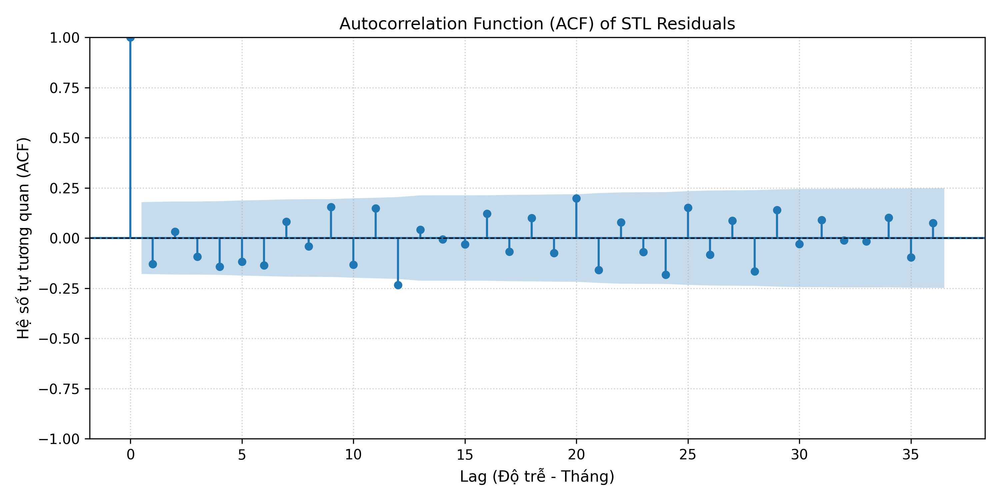

# Phân Tích Thống Kê Chuỗi Thời Gian (Statistical Analysis)

Tài liệu này chi tiết hóa cơ sở lý thuyết, công thức toán học và các phân tích thực nghiệm từ **Bài tập 1 (ACF/PACF)**, **Bài tập 2 (Kiểm định White Noise)** và **Bài tập 3 (Phân rã chuỗi STL)**.

---

## 1. Phân Tích Tự Tương Quan (ACF) & Tự Tương Quan Riêng Phần (PACF)

### 1.1. Khái niệm & Công thức
* **AutoCorrelation Function (ACF):** Đo lường mức độ tương quan tuyến tính giữa $y_t$ và $y_{t-k}$:
  $$\rho_k = \frac{\sum_{t=k+1}^T (y_t - \bar{y})(y_{t-k} - \bar{y})}{\sum_{t=1}^T (y_t - \bar{y})^2}$$
* **Partial AutoCorrelation Function (PACF):** Đo lường mối tương quan trực tiếp giữa $y_t$ và $y_{t-k}$ sau khi đã loại bỏ ảnh hưởng của tất cả các biến trung gian ($y_{t-1}, y_{t-2}, \dots, y_{t-k+1}$).

### 1.2. Kết quả thực nghiệm
* **Hệ số ACF:** Tại lag 1 đạt $\rho_1 \approx 0.774$. Đồ thị ACF giảm chậm dần qua 40 lag (tất cả các lag đều nằm ngoài dải tin cậy $\pm 1.96/\sqrt{N}$). Điều này phản ánh quán tính nhiệt độ cực lớn của tự nhiên.
* **Hệ số PACF:** Cắt cụt đột ngột ngay sau lag 1:
  * Lag 1: $PACF_1 \approx 0.774$.
  * Lag 2 trở đi: Giảm sâu xuống dưới $0.19$.
* **Định danh mô hình:** Đây là dấu hiệu kinh điển của mô hình tự hồi quy bậc 1: **AR(1)**:
  $$y_t = c + \phi_1 y_{t-1} + \epsilon_t$$

---

## 2. Kiểm Định Nhiễu Trắng (White Noise Testing)

### 2.1. Tiêu chuẩn White Noise
Một chuỗi $\{w_t\}$ được gọi là nhiễu trắng thuần túy nếu thỏa mãn 3 điều kiện:
1. Kỳ vọng bằng không: $E[w_t] = 0$.
2. Phương sai không đổi: $Var(w_t) = \sigma^2 < \infty$.
3. Không có tự tương quan: $\rho_k = 0$ với mọi độ trễ $k \neq 0$.

Dải tin cậy 95% lý thuyết:
$$CI = \left[ - \frac{1.96}{\sqrt{N}}, + \frac{1.96}{\sqrt{N}} \right]$$

### 2.2. So sánh thực nghiệm qua 3 kịch bản

| Kịch bản | Quy mô mẫu | Dải tin cậy 95% | Số lag trong dải tin cậy | Kết luận |
|---|---|---|---|---|
| **White Noise Thuần Túy** | 1000 | `[-0.0620, +0.0620]` | **39/40 (97.5%)** | Đạt chuẩn nhiễu trắng ($\le 5\%$ vi phạm do ngẫu nhiên). |
| **Chuỗi Nhiệt Độ Gốc** | 3650 | `[-0.0324, +0.0324]` | **0/40 (0%)** | Hoàn toàn **không phải** White Noise. Chuỗi mang nhiều thông tin dự báo. |
| **Pha nhiễu (Cộng / Thay thế)** | 3650 | `[-0.0324, +0.0324]` | **0/40 (0%)** | Tính chất chuỗi thực bền vững trước nhiễu trắng. |

---

## 3. Phân Rã Chuỗi Thời Gian Bằng STL (Loess Decomposition)

Mô hình phân rã dạng cộng (Additive Model):
$$Y_t = T_t + S_t + R_t$$

Trong đó:
* $Y_t$: Giá trị nhiệt độ quan sát theo tháng.
* $T_t$: Thành phần Xu hướng (Trend).
* $S_t$: Thành phần Mùa vụ (Seasonal).
* $R_t$: Thành phần Dư thừa / Ngẫu nhiên (Residual).

### 3.3. Đánh giá chi tiết từng thành phần
1. **Xu hướng ($T_t$):**
   * Không đơn điệu tuyến tính mà uốn lượn hình sin dài hạn.
   * Giảm từ ~12.0°C (1981) xuống đáy ~10.6°C (1983–1985), sau đó tăng lên đỉnh ~12.0°C (1988) rồi điều chỉnh nhẹ.
2. **Mùa vụ ($S_t$):**
   * Biên độ dao động mạnh và cực kỳ ổn định từ $-5.0^\circ\text{C}$ đến $+5.0^\circ\text{C}$ (chênh lệch đỉnh - đáy lên tới $10^\circ\text{C}$).
   * Chu kỳ mùa vụ chiếm phần lớn năng lượng biến thiên của toàn bộ chuỗi.
3. **Phần dư ($R_t$):**
   * Dao động ngẫu nhiên xung quanh 0 trong phạm vi hẹp `[-1.5°C, +1.5°C]`.
   * **Kiểm định White Noise qua biểu đồ ACF:**
     * Biểu đồ ACF của thành phần dư thừa suy biến nhanh về 0 và dao động ngẫu nhiên quanh mức 0.
     * Tỷ lệ các độ trễ nằm trong khoảng tin cậy 95% ($\pm 1.96/\sqrt{120} \approx \pm 0.1789$) đạt **91.7%** (33/36 lags).
     * Khẳng định thuật toán Loess của STL đã bóc tách triệt để các tín hiệu mang tính quy luật (xu hướng, mùa vụ), chỉ để lại sai số ngẫu nhiên thuần túy (White Noise).

  

