# BÁO CÁO THỰC HÀNH: KHÁM PHÁ & PHÂN TÍCH CHUỖI THỜI GIAN

**Học phần:** Phân Tích Chuỗi Thời Gian (Time Series Analysis)  
**Bài thực hành:** Lab 1 - Khám Phá Đặc Tính & Tiền Xử Lý Dữ Liệu Khí Hậu Melbourne (1981–1990)  
**Tập dữ liệu:** Melbourne Daily Minimum Temperatures (3,650 quan sát)  

---

## 1. Mô tả Dataset

### 1.1. Nguồn gốc & Phạm vi thu thập
* **Tên tập dữ liệu:** Melbourne Daily Minimum Temperatures.
* **Thời gian quan sát:** 10 năm liên tục từ **01/01/1981 đến 31/12/1990**.
* **Đơn vị tần suất gốc:** Hàng ngày (Daily frequency - `D`).
* **Tổng số quan sát:** 3,650 dòng dữ liệu.

### 1.2. Thuộc tính & Kiểu dữ liệu
* `Date`: Chỉ số thời gian (Index) định dạng chuẩn `YYYY-MM-DD`.
* `Temp`: Nhiệt độ tối thiểu đo bằng độ Celsius (°C), kiểu số thực (`float64`).

### 1.3. Thống kê mô tả tổng quan
* **Nhiệt độ trung bình ($\mu$):** $11.18^\circ\text{C}$
* **Độ lệch chuẩn ($\sigma$):** $4.06^\circ\text{C}$
* **Nhiệt độ thấp nhất (Min):** $0.0^\circ\text{C}$ (ghi nhận vào mùa đông)
* **Nhiệt độ cao nhất (Max):** $26.3^\circ\text{C}$ (ghi nhận vào mùa hè)
* **Các mốc phân vị:** $Q_1 (25\%) = 7.0^\circ\text{C}$, $Median (50\%) = 11.0^\circ\text{C}$, $Q_3 (75\%) = 14.1^\circ\text{C}$.

---

## 2. Kiểm tra ACF/PACF

Khảo sát hệ số tự tương quan (ACF) và tự tương quan riêng phần (PACF) đến **40 lags** nhằm đo lường mức độ phụ thuộc thời gian:

  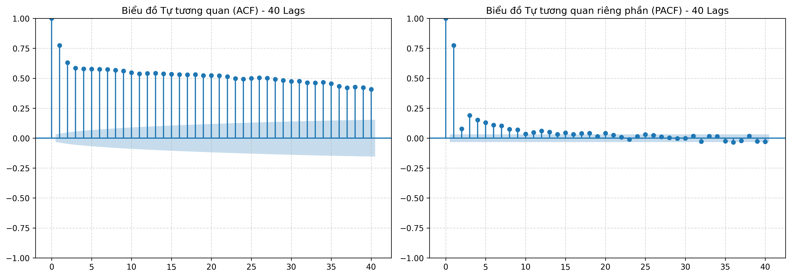
   
  <em>Hình 1: Đồ thị ACF và PACF 40 lags của chuỗi nhiệt độ hàng ngày tại Melbourne.</em>

### Nhận xét & Đánh giá chuyên sâu:
1. **Hệ số ACF:**
   * Tại lag 1 đạt giá trị rất cao: $\rho_1 \approx 0.774$, giảm dần thoai thoải qua 40 lags và toàn bộ đều nằm ngoài dải tin cậy 95% $\left[\pm \frac{1.96}{\sqrt{N}} \approx \pm 0.0324\right]$.
   * Đồ thị ACF suy giảm chậm mang đặc trưng của **"quán tính nhiệt độ"** tự nhiên: ngày hôm trước có tương quan tuyến tính rất mạnh với ngày hôm sau, đồng thời phản ánh chu kỳ biến thiên tuần hoàn theo mùa.
2. **Hệ số PACF:**
   * Xuất hiện hiện tượng **cắt cụt triệt để (cut-off) ngay sau lag 1**: $PACF_1 = 0.774$, từ lag 2 trở đi giảm mạnh về biên độ nhỏ ($< 0.19$).
3. **Định danh mô hình phù hợp:**
   * Dấu hiệu ACF giảm dần thoai thoải kết hợp PACF cắt cụt tại lag 1 là bằng chứng kinh điển xác định thành phần tự hồi quy nền tảng bậc 1: **AR(1)**:
     $$y_t = c + \phi_1 y_{t-1} + \epsilon_t \quad (\phi_1 \approx 0.774)$$

---

## 3. Kiểm tra White Noise (Nhiễu trắng)

Tiêu chuẩn nhận diện chuỗi White Noise thuần túy: không có tự tương quan ($\rho_k = 0, \forall k \neq 0$), có ít nhất 95% số lag nằm trong dải tin cậy $\left[\pm \frac{1.96}{\sqrt{N}}\right]$.

  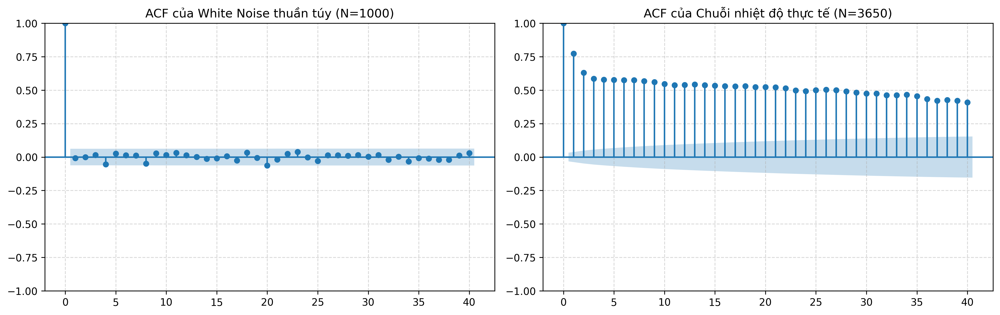
   
  <em>Hình 2: So sánh đồ thị ACF của mẫu White Noise thuần túy (trái) và Chuỗi nhiệt độ thực tế (phải).</em>

### Bảng kết quả đối chứng thực nghiệm:

| Kịch bản kiểm nghiệm | Kích thước mẫu ($N$) | Dải tin cậy 95% ($CI$) | Tỷ lệ lag nằm trong $CI$ | Kết luận |
|---|---|---|---|---|
| **White Noise chuẩn $\mathcal{N}(0, 1)$** | 1,000 | `[-0.0620, +0.0620]` | **39/40 (97.5%)** | Đạt chuẩn nhiễu trắng thuần túy. |
| **Chuỗi nhiệt độ Melbourne gốc** | 3,650 | `[-0.0324, +0.0324]` | **0/40 (0.0%)** | **Bác bỏ hoàn toàn** giả thuyết White Noise. |
| **Thử nghiệm pha nhiễu (PA2 & PA3)** | 3,650 | `[-0.0324, +0.0324]` | **0/40 (0.0%)** | Cấu trúc chuỗi bền vững trước nhiễu. |

> **Ý nghĩa:** Chuỗi nhiệt độ mang tính phụ thuộc thời gian cao, hoàn toàn không phải chuỗi ngẫu nhiên vô nghĩa, chứa đựng nguồn thông tin dồi dào để xây dựng các mô hình dự báo.

---

## 4. Phân rã Chuỗi Thời Gian (STL Decomposition)

Dữ liệu được chuyển đổi sang tần suất tháng (Monthly Mean) và bóc tách bằng phương pháp **STL (Seasonal and Trend decomposition using Loess)** theo mô hình cộng:

$$Y_t = Trend_t + Seasonal_t + Residual_t$$

  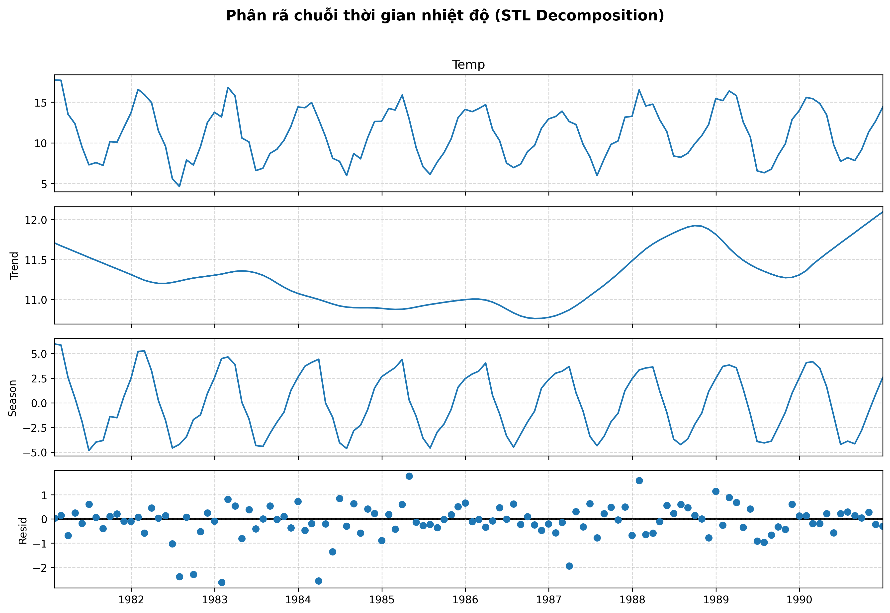
   
  <em>Hình 3: Kết quả phân rã chuỗi nhiệt độ thành Trend, Seasonal và Residual bằng thuật toán STL Loess.</em>

### Phân tích chi tiết từng thành phần:
1. **Xu hướng dài hạn ($Trend_t$):**
   * Không đơn điệu mà mang tính chu kỳ đa năm: giảm nhẹ từ ~12.0°C (1981) xuống đáy ~10.6°C (1983–1984), tăng mạnh trở lại đỉnh ~12.0°C (1988) rồi đi ngang.
2. **Tính mùa vụ ($Seasonal_t$):**
   * Chi phối cực kỳ mạnh mẽ và ổn định đều đặn qua từng năm với biên độ $\pm 5^\circ\text{C}$ (chênh lệch đỉnh - đáy lên tới $10^\circ\text{C}$).
   * Chu kỳ mùa vụ giải thích phần lớn phương sai biến động của toàn bộ chuỗi.
3. **Phần dư thừa ($Residual_t$):**
   * Phân bố ngẫu nhiên xung quanh mức 0 trong phạm vi hẹp `[-1.5°C, +1.5°C]`.
   * Thành phần dư thừa có tính chất xấp xỉ White Noise, chứng minh mô hình STL đã bóc tách triệt để các tín hiệu quy luật của chuỗi.

---

## 5. Vấn đề Chất lượng Dữ liệu (Tiền xử lý)

### 5.1. Xử lý Missing Values (Dữ liệu khuyết thiếu)
* **Thực nghiệm:** Mô phỏng 1% dữ liệu khuyết ngẫu nhiên (MCAR qua [missvl.py](file:///e:/TimeSeries/Lab1_Timeseries/scripts/missvl.py)), tạo ra 33 giá trị NaN.
* **So sánh phương pháp:**
  * *Forward-fill (FFill):* Điền giá trị ngày hôm trước làm xuất hiện các đoạn bậc thang nằm ngang, làm méo mó độ biến thiên thực tế.
  * *Linear Interpolation (Nội suy tuyến tính):* Nối các điểm lân cận mượt mà theo độ dốc tự nhiên $\rightarrow$ **Phương pháp tối ưu nhất**.

  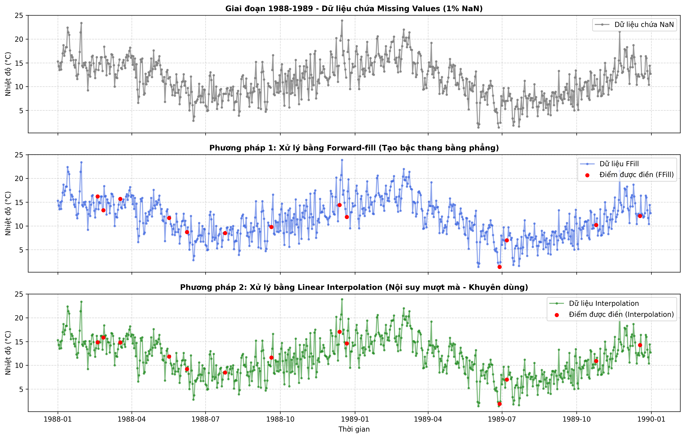
   
  <em>Hình 4: So sánh phương pháp xử lý Missing Values bằng Forward-fill và Linear Interpolation.</em>

---

### 5.2. Phát hiện & Xử lý Outliers (Giá trị ngoại lai)

#### A. Phát hiện Outlier (Trước xử lý)
* **Phương pháp Z-Score ($|Z| > 3$):** Phát hiện **10 điểm dị biệt** ($> 22.8^\circ\text{C}$).
* **Phương pháp IQR ($1.5 \times IQR$):** Dải hợp lệ `[-0.25°C, 22.55°C]`, phát hiện **13 điểm dị biệt** ($> 22.55^\circ\text{C}$).

  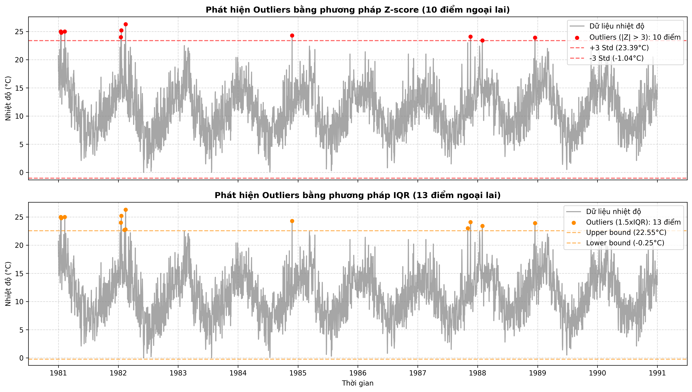
   
  <em>Hình 5: Phát hiện Outliers bằng phương pháp Z-score (|Z| > 3) và IQR (1.5 × IQR).</em>

  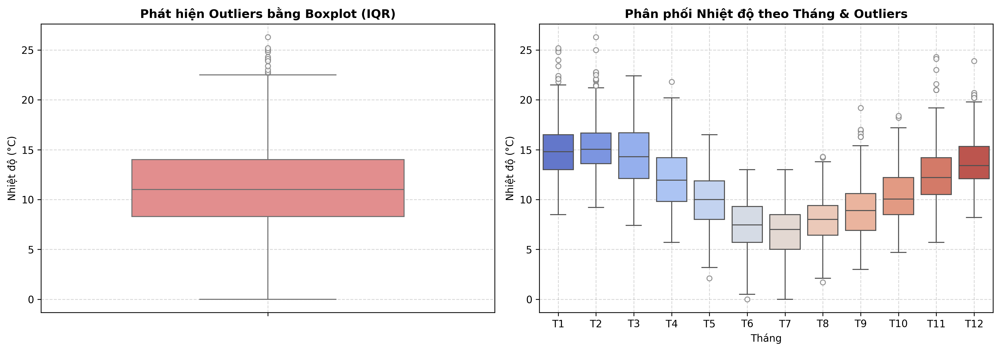
   
  <em>Hình 6: Biểu đồ Boxplot IQR toàn bộ chuỗi (trái) và Phân phối nhiệt độ chi tiết theo từng tháng (phải).</em>

* **Bản chất Outliers:** Tất cả các điểm dị biệt đều rơi vào các tháng mùa hè (tháng 1, 2) tại Nam bán cầu. Đây là hiện tượng **sóng nhiệt tự nhiên (Heatwaves)**, không phải lỗi kỹ thuật.

#### B. Xử lý Outlier (Sau xử lý)
* **Phương án 1 - Clipping / Winsorizing (Khuyên dùng):** Ép các giá trị vượt ngưỡng về ranh giới trên của IQR ($22.55^\circ\text{C}$). Kỹ thuật này triệt tiêu gai nhọn cực trị mà vẫn bảo toàn tính liên tục của chuỗi.
* **Phương án 2 - Interpolation:** Đục bỏ Outliers thành NaN và nội suy lại.

  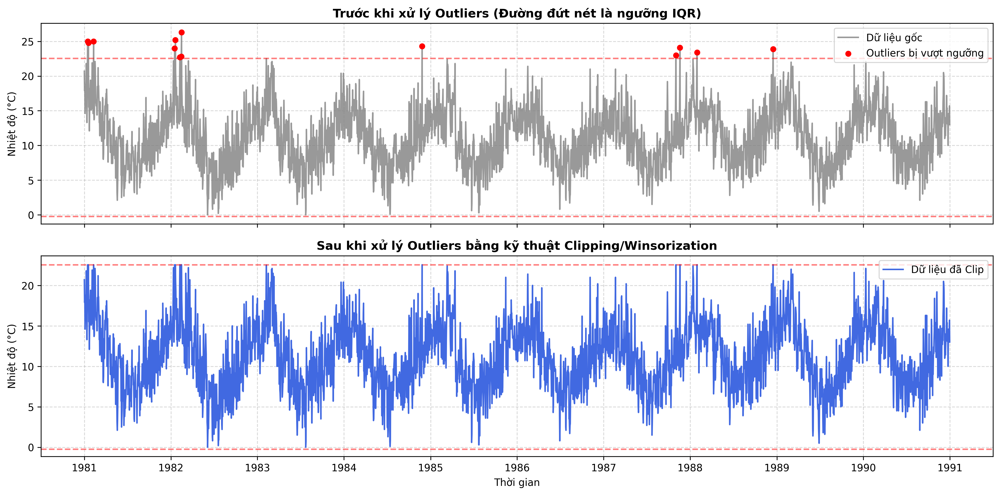
   
  <em>Hình 7: Dữ liệu nhiệt độ Trước và Sau khi xử lý Outlier bằng kỹ thuật Clipping (Winsorization).</em>

  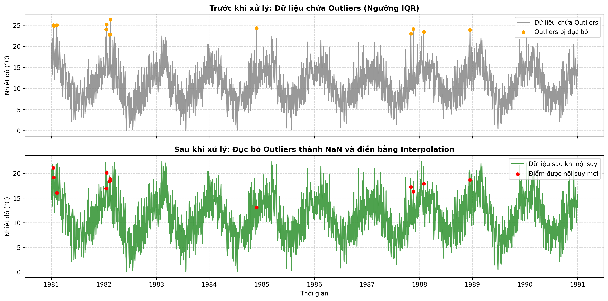
   
  <em>Hình 8: Dữ liệu Trước và Sau khi đục bỏ Outliers và nội suy lại bằng Linear Interpolation.</em>

---

## 6. Ý nghĩa Trực quan hóa Dữ liệu (Bài tập 5)

Trực quan hóa cung cấp góc nhìn đa chiều về đặc tính thời gian, tính dừng sơ bộ và chu kỳ lặp lại:

### 6.1. Line Chart toàn bộ chuỗi (10 năm)
* Thể hiện hình mẫu dao động dạng sóng tuần hoàn điều hòa đều đặn giữa các năm. Biên độ dao động duy trì ổn định, không xuất hiện hiện tượng bùng nổ phương sai (heteroskedasticity).

  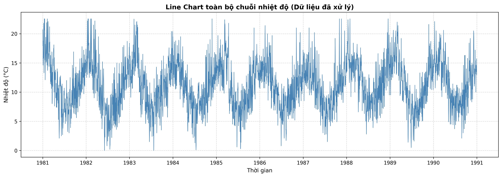
   
  <em>Hình 9: Line Chart toàn bộ chuỗi nhiệt độ 10 năm tại Melbourne sau khi tiền xử lý.</em>

### 6.2. Rolling Statistics (Cửa sổ trượt 12 ngày)
* **Rolling Mean:** Dao động uốn lượn liên tục $\rightarrow$ Chuỗi **chưa dừng về mặt trung bình** do ảnh hưởng của mùa vụ.
* **Rolling Std:** Dao động ổn định quanh mức 2.0°C – 3.5°C, phản ánh phương sai tương đối đồng nhất. Các gai nhọn tập trung ở thời điểm giao mùa (tháng 3–4 và 10–11) do thời tiết biến động thất thường khi chuyển mùa.

  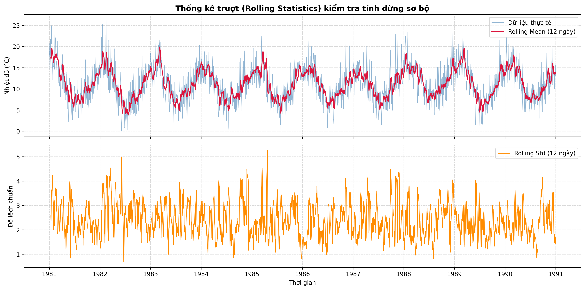
   
  <em>Hình 10: Thống kê trượt (Rolling Mean & Rolling Std cửa sổ 12 ngày) đánh giá tính dừng sơ bộ.</em>

### 6.3. Seasonal Plot theo tháng (Mỗi năm một đường)
* Các đường đồ thị 10 năm đều đồng quy theo dạng chữ U:
  * Đỉnh nhiệt độ tập trung ở **tháng 1 và tháng 2** ($13^\circ\text{C} - 16^\circ\text{C}$).
  * Đáy nhiệt độ rơi vào **tháng 6 và tháng 7** ($6^\circ\text{C} - 8^\circ\text{C}$).
  * Năm 1982 ghi nhận nhiệt độ mùa đông tháng 7 hạ sâu dị biệt xuống gần $4.6^\circ\text{C}$.

  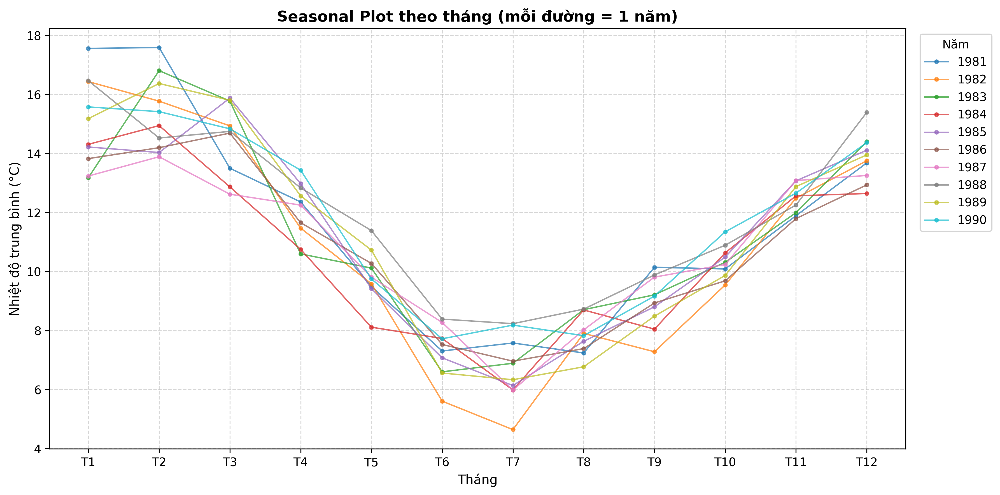
   
  <em>Hình 11: Biểu đồ mùa vụ theo tháng biểu diễn đồng thời 10 năm (1981–1990).</em>

### 6.4. Heatmap Ma trận Mùa vụ (Month × Year)
* Ma trận trực quan hóa sắc thái nhiệt độ: vùng trung tâm (mùa đông tháng 6–8) có tông vàng nhạt, trong khi hai đầu năm (mùa hè tháng 1, 2, 12) mang tông đỏ sẫm. Chu kỳ này lặp lại với độ tin cậy tuyệt đối qua cả 10 năm.

  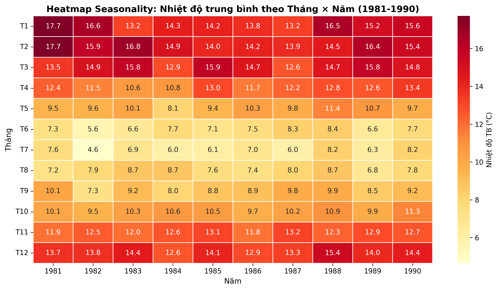
   
  <em>Hình 12: Ma trận nhiệt độ trung bình Tháng × Năm (Heatmap Seasonality).</em>

---

## 7. Kết luận: Dữ liệu có phù hợp để dự báo không?

### 7.1. Khẳng định
> **KẾT LUẬN: Tập dữ liệu nhiệt độ tối thiểu Melbourne HOÀN TOÀN PHÙ HỢP và là một chuỗi thời gian lý tưởng cho bài toán dự báo.**

### 7.2. Các luận cứ khoa học then chốt:
1. **Tín hiệu quy luật vượt trội hơn nhiễu:** Bác bỏ giả thuyết White Noise với 100% các lag ACF vượt dải tin cậy 95%. Dữ liệu không bị chi phối bởi yếu tố ngẫu nhiên thuần túy.
2. **Cấu trúc tự hồi quy AR(1) rõ nét:** Hệ số tự tương quan cao ($\rho_1 \approx 0.774$) và PACF cắt cụt tại lag 1 cho phép dự báo bước tiếp theo ($t+1$) với độ chính xác cao dựa trên giá trị quá khứ gần nhất ($t$).
3. **Tính mùa vụ chu kỳ 365 ngày cực kỳ ổn định:** STL Decomposition và Heatmap chứng minh thành phần Seasonal chiếm tỷ trọng lớn nhất và lặp lại đều đặn, cho phép dự báo xu hướng dài hạn theo mùa một cách chắc chắn.
4. **Chất lượng dữ liệu sạch:** Tỷ lệ khuyết thiếu thực tế rất thấp (0% ở dữ liệu gốc, 0.9% ở kịch bản giả lập). Các ngoại lai đều là hiện tượng tự nhiên có thể kiểm soát hiệu quả bằng Clipping.

### 7.3. Đề xuất định hướng mô hình hóa tiếp theo:
* **Mô hình Thống kê cổ điển:** Cần lấy sai phân theo mùa ($D=1, s=12$ hoặc $s=365$) để triệt tiêu tính không dừng về mùa vụ. Mô hình khuyến nghị là **SARIMA(1, 0, 0)(P, 1, Q)[s]**.
* **Mô hình Học máy / Học sâu:** Tận dụng các biến trễ (Lag features $t-1, t-2, t-7, t-365$), Rolling features và nhãn tháng/mùa làm đầu vào cho **XGBoost, Random Forest, hoặc LSTM/GRU**.
